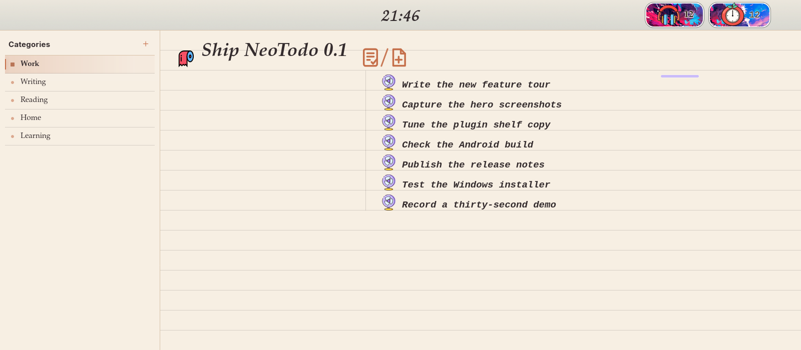
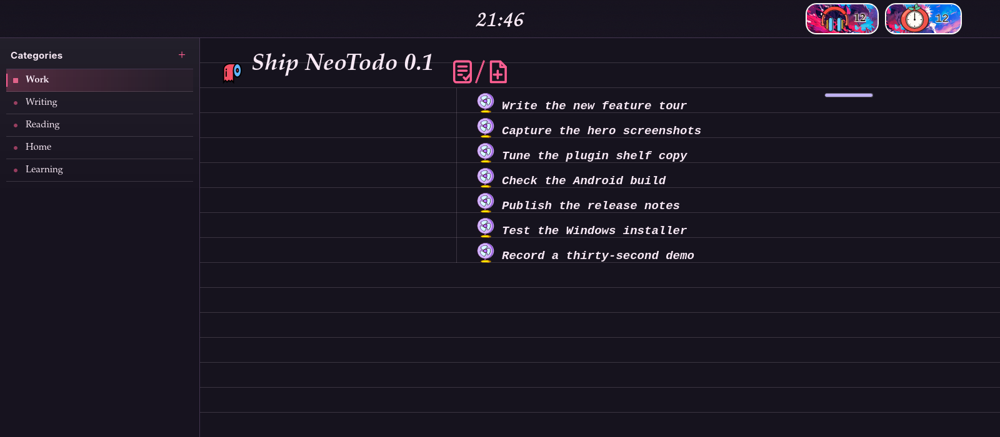

<div align="center">
  
  <h1>NeoTodo</h1>
  <p><strong>One task. One quiet page. One small win at a time.</strong></p>
  <p>NeoTodo is a local-first todo notebook with postcard weeks, paper notes,<br>
  an AI crew, a tomato clock and a shelf of tiny plugins — all in one calm workspace.</p>
  <p>
    <a href="https://github.com/CellMeet/Neotodo/releases/latest"></a>
    <a href="#-run-from-source"></a>
    <a href="https://github.com/CellMeet/Neotodo"></a>
  </p>
</div>

---

NeoTodo is built around a simple feeling: **you only need to see the next thing.** Instead of opening a wall of overdue rows, it gives each category one active todo at a time. Subtasks carry the details, notes and an AI crew sit one gesture away, and every finished week folds itself into a postcard you can keep.

Everything lives on your disk. No account, no cloud, no subscription. The interface is hand-written HTML, CSS and JavaScript over a small Python backend, with native shells for Linux (GTK4 + WebKitGTK), Windows (Qt WebEngine) and Android (Chaquopy).

<p align="center">
  
  
</p>

## ✨ Why NeoTodo feels different

- 🎯 **One next thing.** Each category has a single active todo. The page never turns into a guilt-inducing backlog.
- 🪶 **Quiet by default.** Soft paper, ruled lines, a small clock and a handful of hand-drawn tools. No dashboards, no streak pressure.
- 📮 **Weeks become keepsakes.** Finished work is collected into themed postcards, so progress feels like something you can hold.
- 🧠 **A notebook with a crew.** Paper notes and an AI terminal tile beside your tasks, split, resize and detach into their own windows.
- 🧩 **Small pieces, not a monolith.** Completed-task drawers, search, a music player, a bead studio and more are installable plugins you can switch off.
- 🔒 **Yours, locally.** Tasks, notes, themes and settings are plain JSON on your machine. The AI features connect only to the OpenCode CLI you configure.

## 📥 Download

| | Platform | Package |
| :---: | --- | --- |
| 🪟 | **Windows 10/11 x64** | [NeoTodo-0.0.1-Windows-x64-setup.exe](https://github.com/CellMeet/Neotodo/releases/latest/download/NeoTodo-0.0.1-Windows-x64-setup.exe) |
| 🐧 | **Linux x86_64** | [NeoTodo-0.0.1-Linux-x86_64.tar.gz](https://github.com/CellMeet/Neotodo/releases/latest/download/NeoTodo-0.0.1-Linux-x86_64.tar.gz) |
| 🤖 | **Android** | Build the local debug APK with [`android/build.sh`](android/build.sh) |
| 🍎 | **macOS** | Planned |
| 📱 | **iOS** | Planned |

- 📦 The Windows installer bundles its own Python runtime and Qt WebEngine.
- 🐧 The Linux package is a source package; GTK4, PyGObject and WebKitGTK must already be installed.
- 🤖 The Android build embeds the same Python backend and web workspace, so the desktop logic stays the single source of truth.

## 🧭 Feature tour

### 📮 Postcards, themes and the weekly archive
- 🃏 **Ten postcard palettes** — Violet, Alpine Dawn, Ocean Post, Tokyo Night, Desert Sun, Forest Walk, Northern Lights, Vintage Rose, Deep Space and Emerald, each with its own artwork, ink, accent and stamp.
- 🌗 **Light and dark each remember a favourite.** Keep a bright postcard for the day and a moody one for the night; each mode caches its own choice.
- 🗓️ **Finished weeks archive themselves.** At the start of a new week, the previous week's completed items become a dated postcard in the archive drawer.
- 🎡 **Seasonal archive drawer.** The windmill icon opens every postcard, with entry counts and a per-card summary; click a card to relive the week.
- 🏆 **Trophies and tomatoes.** The header keeps a completion trophy and a focus count, with searchable logs for both achievements.
- 🖼️ **Postcard art as wallpaper.** Use the current postcard scene as a static wallpaper, or swap in your own picture without changing the paper palette.

### ✅ Todos, subtasks and the right-click toolbox
- 🎯 **One active todo per category.** Complete it, celebrate, and the next task rises to the top of the page.
- 🧾 **Subtasks are the real checklist.** Add, rename and tick them inline; completed rows settle into a quiet drawer behind a purple line instead of crowding the work.
- 🖱️ **Right-click anywhere useful.** A live subtask opens **Fork / Copy / Cut / Paste**, a completed one adds **Edit note**, and a note or AI panel opens **Open as new window**.
- 🌬️ **Right-click the fan** in front of a live subtask to delete it in one motion; deleted subtasks are kept in the magic hat.
- 🔀 **Fork a subtask.** A fork branches it into its own category and window, keeping the original untouched and carrying the linked project folder along.
- 🎩 **Magic hat recovery.** Every deleted subtask lands in the hat with its source and timestamp; restore it or clear the hat deliberately.
- 🔍 **Search every subtask.** The magnifier plugin slides a search field out of the subtask header and jumps back to the matching row.
- 🕒 **Time cost on demand.** Optionally show how long each completed task took, straight from creation and completion timestamps.
- 🧲 **Stable ordering.** New tasks appear at the top, completed tasks move aside, and the list keeps its recency when you reopen the app.

### 📝 Notes that feel like paper
- 📄 **A note beside every todo and subtask.** The note card is a real Markdown surface for headings, lists, quotes, code and checklists.
- 🖼️ **Pictures in the margin.** Add images to a note; they stay attached to that todo or subtask and survive restarts.
- 📜 **Paper material.** A warm, ruled notebook page with soft edges and a gentle grain.
- 🧊 **Glass material.** A frosted mask over your chosen background, with adjustable blur and a custom image slot.
- 🎨 **Make the surface yours.** Note materials are small CSS files in a user folder, so you can add your own paper, tint or texture.
- ✍️ **Caret, not cursor.** Choose a line or block caret, its colour, and whether it blinks — independently for notes and the AI console.

### 🤖 The Captain & Crew AI console
- 🧑‍✈️ **Captain · Architect** — a todo-level planning agent that runs through OpenCode's read-only `plan` agent.
- 🛠️ **Crew · Executor** — pick a subtask and the local `opencode` CLI runs with `--auto` to edit the linked project and finish that subtask.
- 🗂️ **One thread per todo and subtask.** Each conversation is saved in `agents.json` and keeps its own OpenCode session.
- 🚦 **Queued, never tangled.** If another crew member is working, a new request waits; an atomic backend lock prevents two agents from editing the same project at once.
- 🧠 **Any OpenCode model.** Press `Ctrl+P` or use the picker to choose from the models reported by `opencode models`; the choice is remembered per thread.
- 💬 **Chat or Build.** The mode picker switches between the read-only planning agent and the auto-editing build agent.
- 📎 **Files as long-term context.** Drop files on the console or use `+`; up to 20 files (10 MB each, 50 MB total) stay attached until you remove their chips.
- 📊 **Honest cost footer.** Session tokens, context usage and spend are shown as a compact line, for example `176.0K (17%) · $10.74`.
- 🧾 **Readable process log.** Tool calls appear as a compact log above each answer, and answers render Markdown.
- 📁 **Bound to a real project.** Link a folder to a todo; the crew reads that project, writes inside it, and the title icon reopens it later.

### 🍅 Focus timer and achievements
- ⏱️ **A 25-minute tomato clock.** Name the task, start the timer, and a hand-drawn tomato keeps the minutes visible.
- 🍅 **Focus log.** Completed sessions are recorded with their task names, searchable from the tomato counter.
- 🖼️ **Achievement stickers.** The trophy and tomato counters use picture stickers; crop, zoom and replace them in **Settings → Pictures**.

### 🎨 Make it yours
- 🃏 **Appearance.** Pick a postcard style per mode, a note material, note background and blur, caret shape and colour, clock visibility, time cost, title position and header icon size.
- 🔤 **Typography.** Six body and note font stacks — Art Serif, Humanist, Bookman, Typewriter, Handwritten and Pen Script — with 85–125% sizing.
- 🖼️ **Pictures.** Static wallpaper from postcard art or your own JPG/PNG/WEBP/GIF/AVIF, or a dynamic wallpaper from a looping MP4/WEBM/MOV.
- 🧷 **Sticker cropping.** The Completed and Pomodoro stickers accept your own image with zoom and crop controls.
- 🔊 **A tiny foley studio.** Typewriter keys, paper tears, water, wind, a train whistle and a steam hiss accompany everyday actions.
- 🎚️ **Sound control.** Toggle sound from the header, adjust volume, preview every sample, or drop your own audio files into the sounds folder.
- 🧩 **A theme community.** Install a `.zip` theme pack to change the palette, wallpaper, foley sounds and achievement stickers together. Export your current look as a shareable pack; publishing is one pull request to [`community/themes.json`](community/themes.json). See [`docs/theme-community.md`](docs/theme-community.md).

### 🧩 Plugins and small tools
- 🧰 **A plugin shelf.** Open the tool rail or **Settings → Plugins** to install, turn off, reconfigure or uninstall each mini-app without touching the notebook core.
- 🪟 **Isolated mini-apps.** Each plugin runs in its own iframe and receives the live light/dark theme, so a plugin can never break the notebook.
- 🌍 **A plugin community.** **Settings → Community** lists plugins shared by other people, with search, tags, authors and one-tap install. The index refreshes from this repository and falls back to an offline copy.
- 📦 **Bring your own plugin.** Install a packaged `.zip` from disk, or publish yours with `tools/pack-plugin.py` and one pull request to `community/catalog.json`.
- 🧵 **The notebook stays small.** Notes, AI and more are on the roadmap as independent plugins, keeping the default workspace light.

### 🪟 Panels, doors and gestures
- 🚪 **Two doors at the bottom.** The AI door sits on the left, the notes door on the right; click to open, click again to close.
- 📏 **Drag to resize.** Hold a door and pull up or down to stretch the sheet; open one panel and it fills the workspace to the bottom edge.
- 🫳 **Long-press to lift away.** Pick up an open panel as a small preview card, then release near an edge to tile it, or over the sidebar to detach it into its own OS window.
- 🧲 **Dock anywhere.** Left, right, top or bottom splits keep the panes flush, with a draggable divider and a smooth FLIP swap when sides change.
- 🔎 **Context menus built in.** Right-click editable text for Cut, Copy, Paste and Select all, with the same clipboard flow across notes, the AI input and task names.
- 🖱️ **Right-edge Doing card.** Hover the subtask column's right border to peek at open todos and expand their subtasks; the card borrows the current wallpaper.

## 🧩 Built-in plugins

| | Plugin | What it does |
| :---: | --- | --- |
| 📥 | **Completed Drawer** | Tucks finished subtasks behind a short purple line under the task header; pull the line down to open the drawer. |
| 🔥 | **Firelight** | Makes the Doing mark glow when an agent finishes: fireflies and lanterns on dark paper, warm embers on light paper. |
| 🌳 | **Forktree** | Draws categories, todos, subtasks and forks as a left-to-right mind map; click any node to jump to it. |
| 💎 | **Head Bar** | A crystal dynamic-island bar slides from the top edge when you hover the clock; click to hide the workspace and reveal the wallpaper. |
| 🎵 | **Music Player** | A neon electronic-music player with a record rail icon, synced LRC lyrics, left/right switching, a clickable library and local imports. |
| 🧵 | **Perler Bead Studio** | A calm bead-by-bead studio for flowers, hearts, stars, mushrooms and cats, with little clicks and a finish chime. |
| 🔍 | **Subtask Search** | A magnifier card in the left rail opens a slide-out search field and jumps to matching subtasks. |

**Community shelf.** Open **Settings → Community** to browse the shared plugin
index, install a `.zip` someone sent you, or package your own plugin with
`python3 tools/pack-plugin.py <folder>`. The catalog and the submission guide
live in [`community/`](community/README.md).

## 🚀 Run from source

### 🐧 Linux

```sh
./run.sh
```

Or preview only the web layer in a browser:

```sh
python3 app.py --serve
```

- 📦 Requirements: Python 3, PyGObject (`python-gobject`), WebKitGTK 6 (`webkit2gtk-4.1` / `webkitgtk-6.0`, depending on distribution) and `xdg-open`.

### 🪟 Windows (development)

```powershell
python -m pip install PySide6
python windows_app.py
```

- 📦 Requirements: Windows 10/11 x64 and PySide6. The release installer bundles both.

### 🤖 Android (emulator, local)

The Android build embeds the same Python backend and web workspace with Chaquopy.

```sh
# 1. Build the debug APK (also copies it to ./NeoTodo-Android.apk)
./android/build.sh

# 2. Boot the tablet emulator, install the APK and launch NeoTodo
./android/run-emulator.sh
```

- 📱 The windowed emulator AVD is `NeoTodo` (API 35, x86_64 tablet, port `5558`); `adb` lives in `$ANDROID_HOME/platform-tools`.
- ⚙️ Override the AVD or port with `NEOTODO_AVD` / `NEOTODO_PORT`. The emulator cold-boots (about a minute) and keeps app data between launches.
- 🖥️ Software GL is the default because the host GPU backend can drop color buffers here; set `NEOTODO_EMU_GPU=host` to try hardware acceleration.
- 🔌 Manual install:

```sh
adb -s emulator-5558 install -r NeoTodo-Android.apk
adb -s emulator-5558 shell am start -n io.github.neotodo/.MainActivity
```

- ↩️ Back closes the topmost dialog, drawer or panel first, then sends the task to the background.
- 🧪 The APK is a local debug build and is not uploaded to GitHub.

### 🧪 Tests

```sh
python3 tests/test_model_icons.py
python3 tests/test_plugin_community.py
```

- ✅ The model test checks that every provider mark exists, is non-empty, and uses the page ink instead of a fixed grey plate.
- ✅ The plugin test covers archive validation, checksum checks, install/uninstall and path traversal.

### 🧱 Build releases

The GitHub Actions workflow `.github/workflows/release.yml` builds:

- 🪟 `NeoTodo-0.0.1-Windows-x64-setup.exe` with PyInstaller + Inno Setup
- 🐧 `NeoTodo-0.0.1-Linux-x86_64.tar.gz` as the Linux source package

Push a version tag to publish a release:

```sh
git tag v0.0.1
git push origin v0.0.1
```

## ⌨️ Keyboard at a glance

- 🗂️ `Tab` — toggle the category spine
- ↕️ `j` / `k` — move through tasks; with the category spine focused, move between categories
- ❌ `q` — close the current panel, postcard or log
- 🤖 `Ctrl+P` — cycle the AI terminal model
- ✉️ `Enter` / `Shift+Enter` — send / newline in the AI terminal
- ✅ `Enter` — confirm a new todo after the confirmation dialog
- 🧯 `Esc` — dismiss the topmost menu, dialog or panel

## 🗂️ Where your data lives

- 🐧 **Linux:** `~/.local/share/neotodo/NeoTodo.json`
- 🪟 **Windows:** `%APPDATA%\NeoTodo\NeoTodo.json`
- 🍎 **macOS (planned):** `~/Library/Application Support/NeoTodo/NeoTodo.json`
- 🤖 **Android:** app-private `files/.local/share/neotodo/NeoTodo.json` (inspect with `adb shell run-as io.github.neotodo cat ...`)
- 🧠 **AI threads:** `agents.json` beside the main data file
- 🖼️ **Media:** `pictures/`, `music/`, `sounds/` and `note-materials/` in the same data folder
- ☁️ **Cloud:** none. NeoTodo never uploads your notebook; the AI crew only talks to the OpenCode CLI on your machine.

## 🗺️ Roadmap

- [x] 🐧 Linux
- [x] 🪟 Windows x64
- [x] 🤖 Android (local debug build + emulator)
- [x] 🧩 Plugin community catalog + install from `.zip`
- [ ] 🍎 macOS
- [ ] 📱 iOS
- [ ] 🧩 Notes and AI as independent plugins

## 💛 Support NeoTodo

- ⭐ Star the repository if it makes your day a little quieter.
- 🐛 Open an issue for a bug or a small idea.
- 🧩 Share a plugin, a note material or a sound pack.
- ☕ Buy me a coffee if you would like to keep the paper coming.

### ☕ Buy me a coffee

If NeoTodo helps you, you can support its development with a small donation. Every contribution goes into paper, ink and the next quiet detail.


## 🔗 Project

- 🌐 **Repository:** https://github.com/CellMeet/Neotodo
- ✉️ **Email:** cellmeet@163.com
- 🏷️ **Version:** 0.0.1
