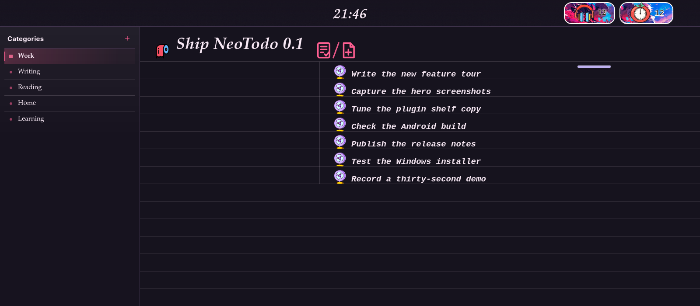

<div align="center">
  
  <h1>NeoTodo</h1>
  <p><strong>One task. One quiet page. One small win at a time.</strong></p>
  <p>NeoTodo is a local-first todo notebook with postcard weeks, paper notes,<br>
  an AI crew and a shelf of tiny plugins — all in one calm workspace.</p>
  <p>
    <a href="https://github.com/CellMeet/Neotodo/releases/latest"></a>
  </p>
</div>

---

NeoTodo is built around one feeling: **you only need to see the next thing.** Each category shows a single active todo instead of a wall of overdue rows. Subtasks carry the details, a note and an AI crew sit one gesture away, and finished weeks fold into postcards you can keep.

Everything lives on your disk. No account, no cloud, no subscription. The interface is hand-written HTML, CSS and JavaScript over a small Python backend, with native shells for Linux (GTK4 + WebKitGTK), Windows (Qt WebEngine), macOS (PyObjC + WKWebView), Android (Chaquopy) and iOS (CPython + WKWebView).

<p align="center">
  
  
</p>

## ✨ Why NeoTodo feels different

- 🎯 **One next thing.** Each category keeps a single active todo, so the page never becomes a backlog.
- 🪶 **Quiet by default.** Soft paper, ruled lines, a small clock and a handful of hand-drawn tools. No dashboards, no streaks, no guilt.
- 📮 **Weeks become keepsakes.** Finished work is collected into themed postcards, so progress feels like something you can hold.
- 🧠 **A notebook with a crew.** Paper notes and an AI terminal tile beside your tasks; split, resize, detach and dock them.
- 🧩 **Small pieces, not a monolith.** Completed drawers, search, music, a bead studio and more are installable plugins you can switch off.
- 🔒 **Yours, locally.** Tasks, notes, themes and settings are plain JSON on your machine. AI features only talk to the OpenCode CLI you configure.

## 📥 Download

| | Platform | Package |
| :---: | --- | --- |
| 🪟 | **Windows 10/11 x64** | [NeoTodo-0.0.1-Windows-x64.zip](https://github.com/CellMeet/Neotodo/releases/latest/download/NeoTodo-0.0.1-Windows-x64.zip) |
| 🐧 | **Linux x86_64** | [NeoTodo-0.0.1-Linux-x86_64.tar.gz](https://github.com/CellMeet/Neotodo/releases/latest/download/NeoTodo-0.0.1-Linux-x86_64.tar.gz) |
| 🤖 | **Android** | Build the debug APK or a signed store build with [`NeoTodo-Android/build-release.sh`](NeoTodo-Android/build-release.sh) |
| 🍎 | **macOS 11+** | Build from source in [`NeoTodo-MacOS/`](NeoTodo-MacOS/README.md) |
| 📱 | **iOS / iPadOS 15+** | Build from source in [`NeoTodo-iOS/`](NeoTodo-iOS/README.md) |

- 📦 The Windows download is a `.zip` holding the installer: unzip it, run `NeoTodo-0.0.1-Windows-x64-setup.exe`, and click through the wizard. It bundles its own Python runtime and Qt WebEngine.
- 🐧 The Linux package is a source package; GTK4, PyGObject and WebKitGTK must already be installed.
- 🍎 The macOS build is a native PyObjC + WKWebView shell around the same backend.
- 📱 The iOS build embeds CPython in a Swift + WKWebView shell; the App Store walkthrough is in [`NeoTodo-iOS/store/app-store-publish.md`](NeoTodo-iOS/store/app-store-publish.md).
- 🤖 The Android build embeds the same Python backend and web workspace, so desktop logic stays the single source of truth.

> 🧩 想自己托管下载页和插件目录？[`site/`](site/) 是一套可以直接放到阿里云 ECS 的静态站点：软件下载卡片、可搜索的插件架、自动生成 sha256 的构建脚本和 Nginx 配置都在里面，见 [`site/README.md`](site/README.md)。

## 🧭 Feature tour

### 📮 Postcards, themes and the weekly archive
- 🃏 **Nine postcard palettes** — Alpine Dawn, Ocean Post, Tokyo Night, Desert Sun, Forest Walk, Northern Lights, Vintage Rose, Deep Space and Emerald, each with its own artwork, ink, accent and stamp.
- 🌗 **Light and dark each remember a favourite.** Keep a bright postcard for the day and a moody one for the night.
- 🗓️ **Finished weeks archive themselves.** At the start of a new week, the previous week's completed items become a dated postcard in the archive drawer.
- 🎡 **A seasonal archive drawer.** The Postcards plugin opens every week in a Settings-style sheet, with entry counts and a per-card summary.
- 🏆 **Trophies and tomatoes.** The header keeps a completion trophy and a focus count, each with a searchable log.
- 🖼️ **Your own wallpaper.** Pick any picture or film from **Appearance → Wallpaper**. NeoTodo remembers the path and reads the file in place; nothing is copied.
- 🃏 **Sub-cards.** The live subtask card, the right-edge Doing card and the finished-subtasks card are each baked out of the wallpaper around their own box, so every card is its own sheet of the room rather than a see-through hole.

### 🎨 Appearance, fonts and icon themes
- 🎨 **One Theme row.** App, note and AI palettes at a glance; open it to pick a theme, manage packs, or fine-tune the underline, add/complete accents and the selected-cell wash.
- 🖼️ **Wallpaper cards.** A still picture bakes a card-sized piece of the room; a film bakes its paused middle frame, so every card is a still of the same scene.
- 🌗 **Light and dark caches.** Each mode remembers its own postcard, wallpaper and palette choice.
- 🔤 **Font.** Six body and note font stacks — Art Serif, Humanist, Bookman, Typewriter, Handwritten and Pen Script — with independent sizes.
- 🏷️ **Icon themes.** Classical keeps the original napkin, headphones, fan and fork flame. **PvZ** swaps in the chomper, puffshroom, sunshroom, tallnut, cherry, coffee bean and a burning-row delete effect.
- 🧷 **Stickers.** The trophy and Pomodoro tomato badges accept your own picture; stickers live inside the notebook and **Default** brings the original artwork back.
- 🃏 **Card pictures.** Every floating card accepts its own picture in **Settings → Card**, with a crop box so only the chosen part becomes the surface.
- 🎚️ **Line control.** **Settings → Font** switches the page baseline and the card line on or off; the Palette plugin opens the same line language as a compact colour sheet.

### ✅ Todos, subtasks and the right-click toolbox
- 🎯 **One active todo per category.** Complete it, celebrate, and the next task rises to the top of the page.
- 🧾 **Subtasks are the real checklist.** Add, rename and tick them inline; completed rows settle into a quiet drawer behind a purple line instead of crowding the work.
- 🏁 **Twenty finished subtasks arm one-click submit.** At that point the complete action offers to finish the remaining rows with the todo.
- 🖱️ **Right-click anywhere useful.** A live subtask body opens **Fork / Cut**, a completed one opens **Fork / Copy name / Edit note**, and a note or AI panel opens **Open as new window**.
- 🌬️ **Right-click the fan** in front of a live subtask to delete it in one motion; deleted subtasks are kept in the magic hat.
- 🔀 **Fork a subtask.** A fork branches it into its own category and window, keeping the original untouched and carrying the linked project folder along.
- 🎩 **Magic hat recovery.** Every deleted subtask lands in the hat with its source and timestamp; restore it or clear the hat deliberately.
- 🔍 **Search every subtask.** The magnifier plugin slides a search field out of the subtask header and jumps back to the matching row; Enter creates a new subtask when nothing matches.
- 🕒 **Time cost on demand.** Optionally show how long each completed task took, straight from creation and completion timestamps.
- 📁 **A real project folder per todo.** Link a folder to a todo; the AI crew reads and writes there, and the title icon reopens it later.

### 📝 Notes that feel like paper
- 📄 **A note beside every todo and subtask.** The note card is a real Markdown surface for headings, lists, quotes, code and checklists.
- 🖼️ **Pictures in the margin.** Add images to a note; they stay attached to that todo or subtask and survive restarts.
- 📜 **Paper material.** A warm, ruled notebook page with soft edges and a gentle grain.
- 🧊 **Glass material.** A frosted mask over your chosen background, with adjustable blur and a custom image slot.
- 🎨 **Make the surface yours.** Note materials are small CSS files in a user folder, so you can add your own paper, tint or texture.
- ✍️ **Caret, not cursor.** Choose a line or block caret, its colour, and whether it blinks — independently for notes and the AI console.

### 🤖 The Captain & Crew AI console
- 🧑‍✈️ **Captain · Architect** — a todo-level planning agent that runs through OpenCode's read-only `plan` agent.
- 🛠️ **Crew · Executor** — pick a subtask and the local `opencode` CLI runs with `--auto` to edit the linked project and finish that subtask.
- 🗂️ **One thread per todo and subtask.** Each conversation is saved in `agents.json` and keeps its own OpenCode session.
- 🚦 **Queued, never tangled.** If another crew member is working, a new request waits; an atomic backend lock prevents two agents from editing the same project at once.
- 🧠 **Any OpenCode model.** Press `Ctrl+P` or use the picker to choose from the models reported by `opencode models`; the choice is remembered per thread.
- 💬 **Chat or Build.** The mode picker switches between the read-only planning agent and the auto-editing build agent.
- 📎 **Files as long-term context.** Drop files on the console or use `+`; up to 20 files (10 MB each, 50 MB total) stay attached until you remove their chips.
- 📊 **Honest cost footer.** Session tokens, context usage and spend are shown as a compact line, for example `176.0K (17%) · $10.74`.
- 🧾 **Readable process log.** Tool calls appear as a compact log above each answer, and answers render Markdown.
- 🧯 **Pause when you need to.** `Esc` interrupts the running agent without closing the console.

### 🍅 Pomodoro and achievements
- ⏱️ **A 25-minute Pomodoro.** The opt-in Pomodoro plugin adds a tomato counter beside the headphone achievement; each finished focus round adds one.
- 🍅 **Focus log.** Completed sessions are recorded with their task names, searchable from the tomato counter.
- 🖼️ **A sticker for every achievement.** The completed trophy and the Pomodoro tomato each take a picture in **Settings → Stickers**.

### 🎵 Music and sound
- 🔊 **A tiny foley studio.** Typewriter keys, paper tears, water, wind, a train whistle and a steam hiss accompany everyday actions.
- 🎚️ **Sound control.** Toggle sound from the header, adjust volume, preview every sample, or drop your own audio files into the sounds folder.
- 🎼 **Sound styles.** Each sounds shelf can hold its own set; switch the whole foley palette in **Settings → Music**.
- 🎵 **Background music.** Point NeoTodo at a folder of audio files and pick a track; the choice and its on/off switch are remembered.
- 💿 **Neon Terminal.** The Music Player plugin adds a record rail icon, synced LRC lyrics, left/right switching and a clickable local library.

### 🧩 Plugins and the community
- 🧰 **A plugin shelf.** Open the tool rail or **Settings → Plugins** to install, turn off, reconfigure or uninstall each mini-app without touching the notebook core.
- 🪟 **Isolated mini-apps.** Each plugin runs in its own iframe and receives the live light/dark theme, so a plugin can never break the notebook.
- 🌍 **A plugin community.** The Community plugin unites themes, games and plugins behind one switcher; the shelf lists shared work with search, tags, authors and one-tap install, and falls back to an offline copy.
- 📦 **Bring your own plugin.** Install a packaged `.zip` from disk, or publish yours with `tools/pack-plugin.py` and one pull request to `community/catalog.json`.
- 🧵 **The notebook stays small.** Notes and AI are on the roadmap as independent plugins, keeping the default workspace light.

### 🪟 Panels, doors and gestures
- 🚪 **Two doors at the bottom.** The AI door sits on the left, the notes door on the right; click to open, click again to close.
- 📏 **Drag to resize.** Hold a door and pull up or down to stretch the sheet; open one panel and it fills the workspace to the bottom edge.
- 🫳 **Long-press to lift away.** Pick up an open panel as a small preview card, then release near an edge to tile it, or over the sidebar to detach it into its own OS window.
- 🧲 **Dock anywhere.** Left, right, top or bottom splits keep the panes flush, with a draggable divider and a smooth swap when sides change.
- 🔎 **Context menus built in.** Right-click editable text for Cut, Copy, Paste and Select all, with the same clipboard flow across notes, the AI input and task names.
- 🖱️ **Right-edge Doing card.** Hover the subtask column's border to peek at open todos and expand their subtasks; the card borrows the current wallpaper and can be docked to either side.

## 🧩 Built-in plugins

| | Plugin | What it does |
| :---: | --- | --- |
| 🌍 | **Community** | Turns the shared plugin and theme shop into its own page, so installs, previews and updates happen without leaving the workspace. |
| 📥 | **Completed Drawer** | Collects finished subtasks behind a short purple line; pull the line down to open the drawer. |
| 🧚 | **Fireflies** | Floating lights around the Doing mark when an agent finishes: fireflies and paper lanterns on dark paper, warm embers on light paper. |
| 🔥 | **Firelight** | A warm fire effect on the Doing mark when an agent finishes, with embers that rise instead of bursting. |
| 🌳 | **Forktree** | Forks a subtask into an independent NeoTodo window with its own port, note and AI thread; the original stays untouched. |
| 💎 | **Head Bar** | A crystal dynamic-island bar slides from the top edge when you hover the clock; hide the workspace by sliding or by burning the paper away. |
| ⚡ | **White Lightning** | Wraps the Doing mark in three strands of white lightning when an agent finishes. |
| 🎵 | **Music Player** | A neon electronic-music player with a record rail icon, synced LRC lyrics, left/right switching and local imports. |
| 🎨 | **Palette** | Page lines, selection highlight and completed rows in one compact colour sheet. |
| 🧵 | **Perler Bead Studio** | A calm bead-by-bead studio for flowers, hearts, stars, mushrooms and cats, with little clicks and a finish chime. |
| 🍅 | **Pomodoro** | A 25-minute focus timer with a tomato counter and focus log beside the headphone achievement. |
| 📮 | **Postcards** | Prints each finished week as a postcard and opens the archive by year and month. |
| 📦 | **Storage Box** | Keeps unused categories in a box at the foot of the spine and returns them to the list when you need them. |
| 🔍 | **Subtask Search** | A magnifier card in the left rail opens a slide-out search field and jumps to matching subtasks. |

**Community shelf.** Browse the shared index in the Community plugin, install a `.zip` someone sent you, or package your own with `python3 tools/pack-plugin.py <folder>`. The catalog and the submission guide live in [`community/`](community/README.md).

## 🚀 Run from source

### 🐧 Linux

```sh
./run.sh
```

Or preview only the web layer in a browser:

```sh
python3 app.py --serve
```

- 📦 Requirements: Python 3, PyGObject (`python-gobject`), WebKitGTK 6 and `xdg-open`.

### 🪟 Windows

Download the release, unzip it, run `NeoTodo-0.0.1-Windows-x64-setup.exe`, then start NeoTodo from the Start Menu. Data lives in `%APPDATA%\NeoTodo`; **Uninstall NeoTodo** is in the NeoTodo Start Menu folder.

Build the installer yourself:

```powershell
powershell -ExecutionPolicy Bypass -File windows-build.ps1
```

### 🍎 macOS (development)

```sh
cd NeoTodo-MacOS
python3 -m pip install -r requirements.txt
./run-macos.sh
```

- 📦 macOS 11+, Python 3.10–3.13. `./build.sh` packages a native `NeoTodo.app`.
- 🔏 Signing, notarization and App Store steps are in [`NeoTodo-MacOS/README.md`](NeoTodo-MacOS/README.md).

### 📱 iOS (source build)

```sh
cd NeoTodo-iOS
./Scripts/fetch-python.sh
./Scripts/generate-project.sh
open NeoTodo.xcodeproj
```

- 📦 macOS + Xcode 15+, `brew install xcodegen`, ~40 MB for `Python.xcframework`.
- 🔏 `TEAM_ID=ABCDE12345 ./Scripts/archive.sh` exports the App Store `.ipa`; the checklist is in [`NeoTodo-iOS/store/app-store-publish.md`](NeoTodo-iOS/store/app-store-publish.md).

### 🤖 Android (source build)

```sh
cd NeoTodo-Android
./build.sh            # debug APK, also copied to ../NeoTodo-Android.apk
./run-emulator.sh     # boot the tablet emulator and launch NeoTodo
./build-release.sh --apk   # signed build once keystore.properties exists
```

- 📱 The windowed AVD is `NeoTodo` (API 35, x86_64 tablet, port `5558`); override with `NEOTODO_AVD` / `NEOTODO_PORT`.
- 🔏 Copy `keystore.properties.example` to `keystore.properties` before a store build.

### 🧪 Tests

```sh
for test in tests/test_*.py; do python3 "$test"; done
```

## ⌨️ Keyboard at a glance

- 🗂️ `Tab` — toggle the category spine
- ↕️ `j` / `k` — move through tasks; with the category spine focused, move between categories
- ❌ `q` — close the current panel, postcard or log
- 🤖 `Ctrl+P` — cycle the AI terminal model
- ✉️ `Enter` / `Shift+Enter` — send / newline in the AI terminal
- ✅ `Enter` — confirm a new todo after the confirmation dialog
- 🧯 `Esc` — dismiss the topmost menu, dialog or panel

## 🗂️ Where your data lives

- 🐧 **Linux:** `~/.local/share/neotodo/NeoTodo.json`
- 🪟 **Windows:** `%APPDATA%\NeoTodo\NeoTodo.json`
- 🍎 **macOS:** `~/Library/Application Support/NeoTodo/NeoTodo.json`
- 🤖 **Android:** app-private `files/.local/share/neotodo/NeoTodo.json`
- 🧠 **AI threads:** `agents.json` beside the main data file
- 🖼️ **Media:** `pictures/`, `music/`, `sounds/` and `note-materials/` in the same data folder
- ☁️ **Cloud:** none. NeoTodo never uploads your notebook; the AI crew only talks to the OpenCode CLI on your machine.

## 🗺️ Roadmap

- [x] 🐧 Linux
- [x] 🪟 Windows x64
- [x] 🍎 macOS (source build + App Store path documented)
- [x] 🤖 Android (source build + store signing kit)
- [x] 📱 iOS (source build + TestFlight/App Store guide)
- [x] 🧩 Plugin community catalog + install from `.zip`
- [ ] 🧩 Notes and AI as independent plugins

## ☕ Buy me a coffee

If NeoTodo makes your day a little quieter, you can buy me a coffee.


